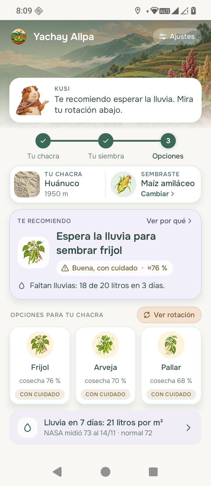
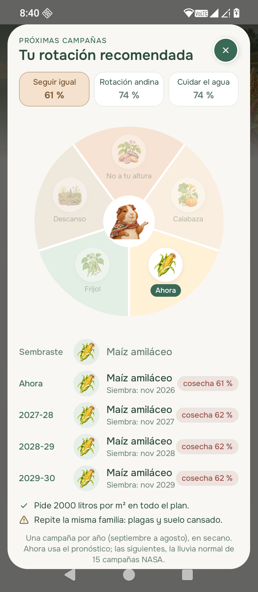
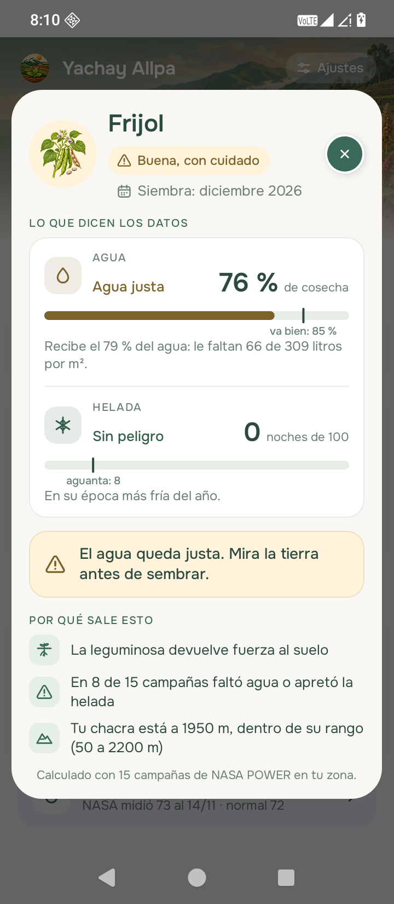
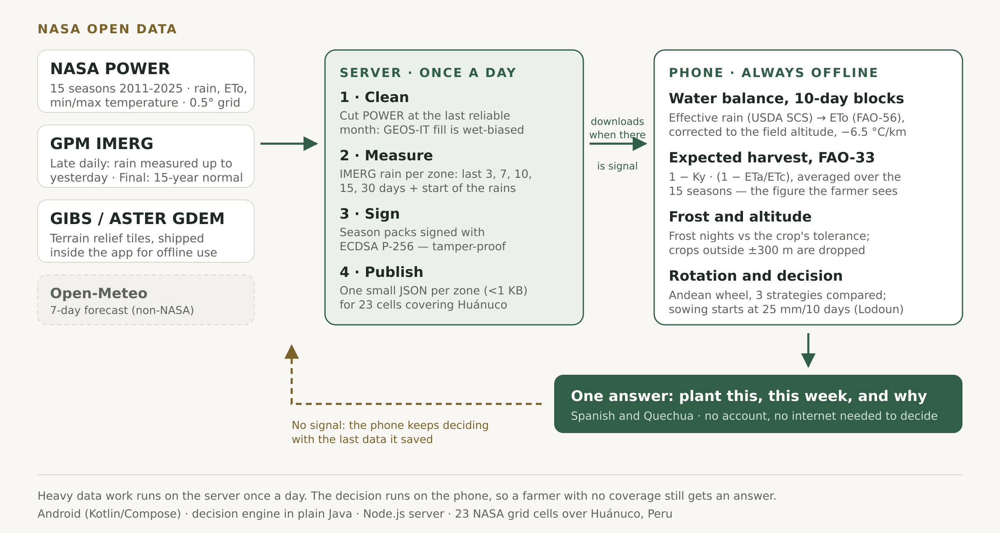
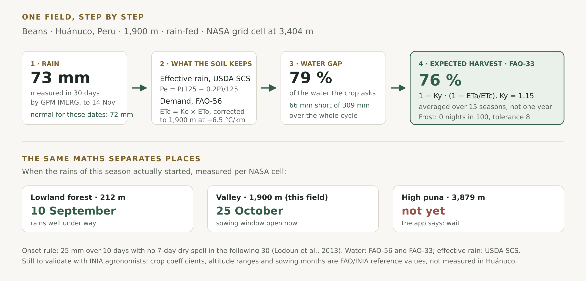
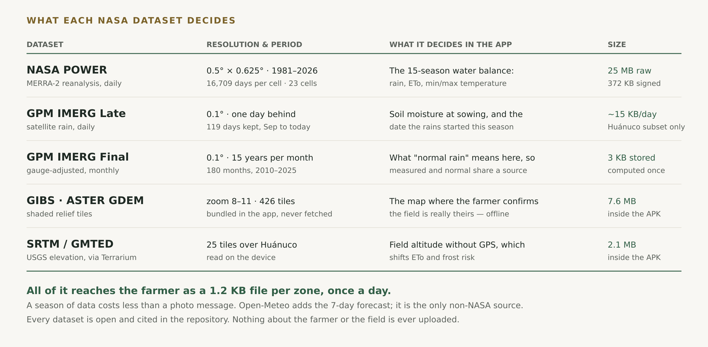
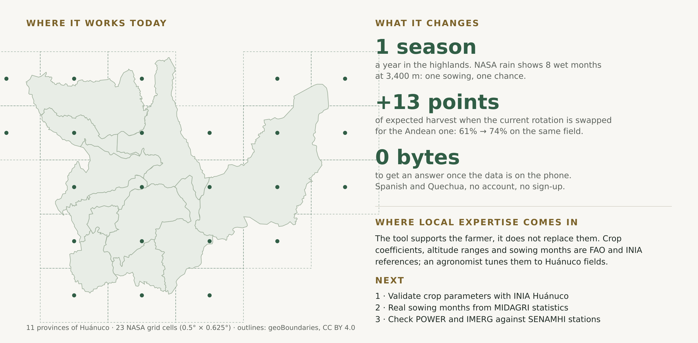

<div align="center">

# Yachay Allpa

**What to plant, when, and why — NASA data for Andean farmers, offline.**

A crop-rotation decision tool for the 11 provinces of Huánuco, Peru.
Built for the NASA Space Apps Challenge 2026 — *Field Shift: Adapting Farms with NASA Data*.

[](LICENSE)
[](#building-it)
[](#the-nasa-data-and-what-each-one-decides)
[](#why-offline-is-the-whole-point)





</div>

---

## The problem

In the Andes of Huánuco there is **one rain-fed season a year**. A farmer chooses what to
sow once, and if the rain fails or the frost comes early, the year is lost. NASA has
measured that rain for decades — but it lives in global grids, in English, behind an
internet connection that the field does not have.

Repeating the same crop season after season is the common fallback, and it is the
expensive one: on a real field at 1,900 m, keeping the current rotation returns **61 %**
of what the land could give, while two alternatives reach **74 %** — same field, same
NASA data.

## What it does

One screen, one answer, and the numbers behind it.

| | |
|---|---|
| **Tells you what to sow, and when** | "Plant beans this week" — or wait, or rest the land. Never a list of options with no verdict. |
| **Compares three rotation strategies** | Keep as is · Andean rotation · Water-saving. Each with its expected harvest, what it gains and what it risks. |
| **Shows the evidence** | Expected harvest, water gap in litres per m², frost nights out of 100, all for that exact field. |
| **Works with no signal** | Everything heavy is precomputed. The decision runs on the phone. |
| **Speaks the local languages** | Spanish and Quechua, with no account and no sign-up. |

## How it works

<div align="center">

</div>

Heavy data work runs on a small server once a day. The decision runs on the phone, so a
farmer with no coverage still gets an answer.

### Why offline is the whole point

Mobile coverage in rural Huánuco is partial and expensive. So the phone never needs the
network to decide: season packs ship inside the APK, the daily file is **1.2 KB** per
zone, and the relief map is bundled. Once the data is on the device, a recommendation
costs **zero bytes**.

## The science behind each number

<div align="center">

</div>

The chain is deliberately boring and traceable:

1. **Effective rain** — USDA SCS method as applied by FAO CROPWAT: `Pe = P(125 − 0.2P)/125`.
2. **Crop demand** — FAO-56: `ETc = Kc × ETo`, with ETo corrected from the NASA cell
   altitude to the field altitude at −6.5 °C/km.
3. **Expected harvest** — FAO-33 (Doorenbos & Kassam, 1979):
   `1 − Ky · (1 − ETa/ETc)`, averaged over 15 seasons, not a single year.
4. **Start of sowing** — 25 mm over 10 days with no 7-day dry spell in the following 30
   (Lodoun et al., 2013), measured by satellite; or 20 mm in 3 days (Sivakumar, 1988)
   when the season has not started yet.
5. **Frost** — nights below the crop's tolerance, with the minimum temperature corrected
   to the field altitude.

The verdict shown to the farmer is the **worst** of three: score, water and frost. It can
never say "good option" while the water gauge says otherwise.

## The NASA data, and what each one decides

<div align="center">

</div>

| Dataset | Role |
|---|---|
| [NASA POWER](https://power.larc.nasa.gov/) (MERRA-2) | 15 seasons of rain, ETo and temperature — the water balance |
| [GPM IMERG Late](https://doi.org/10.5067/GPM/IMERGDL/DAY/07) | Rain measured up to yesterday: soil moisture at sowing, start of the rains |
| [GPM IMERG Final](https://doi.org/10.5067/GPM/IMERG/3B-MONTH/07) | What "normal rain" means here, from the same source as the measurement |
| [NASA GIBS](https://nasa-gibs.github.io/gibs-api-docs/) · ASTER GDEM | The offline relief map where the farmer confirms the field |
| SRTM / GMTED (USGS, via Terrarium tiles) | Field altitude with no GPS, which shifts ETo and frost risk |

POWER fills its most recent months with GEOS-IT, which is biased wet. The pipeline, the
server and the phone all cut the series at the last reliable month and use IMERG for
anything newer. Full citations: [SOURCES.md](SOURCES.md).

## Where it works, and where local expertise comes in

<div align="center">

</div>

The tool supports the farmer, it does not replace them. Crop coefficients, altitude ranges
and sowing months are FAO and INIA reference values, not measured in Huánuco; an agronomist
needs to tune them to local fields. The three next steps are listed in the figure above.

## Repository layout

```
core/            Decision engine, plain Java 11 — no Android, fully testable
  MotorTemporada   water balance in 10-day blocks over 15 NASA seasons
  Decision         one action: sow, wait for rain, wait for frost, rest
  PlanRotacion     the Andean wheel and the three strategies compared
  Veredicto        the worst of score, water and frost
app/             Android app, Kotlin + Jetpack Compose, Spanish and Quechua
pipeline/        Builds and signs the season packs; full test suite
servidor-datos/  Node.js daily job: IMERG rain, onset, forecast, one JSON per zone
herramientas/    Python helpers: download the NASA relief tiles, check the translations
docs/img/        Figures and screenshots used in this README
```

## Building it

```bash
# Tests for the engine (no Android needed)
JAVA_HOME=/usr/lib/jvm/java-21-openjdk-amd64 ./gradlew :pipeline:pruebas

# Debug APK
JAVA_HOME=/usr/lib/jvm/java-21-openjdk-amd64 ANDROID_HOME=/usr/lib/android-sdk \
  ./gradlew :app:assembleDebug
```

The server job needs Node.js 18+ and a free [NASA Earthdata](https://urs.earthdata.nasa.gov/)
token in `servidor-datos/.earthdata` (never committed).

```bash
cd servidor-datos && DATOS_DIR=/path/to/data node actualizar.js
```

## Data integrity

Season packs are signed with **ECDSA P-256** and verified on the device before use: a
tampered pack is rejected, so bad data cannot reach a farmer's decision. The app sends
nothing about the farmer or the field anywhere — GPS stays on the phone, and only the
fixed centre of the NASA grid cell is ever used to fetch data.

## Credits and licence

Code and documentation under [Apache 2.0](LICENSE). Every dataset, method, formula and font
used is listed with its licence and citation in [SOURCES.md](SOURCES.md). The engine itself
is commented in detail, and `pipeline/src/test` holds the test suite that keeps the rules
honest.

Team **HenDx** · NASA Space Apps Challenge 2026 · Huánuco, Peru.
